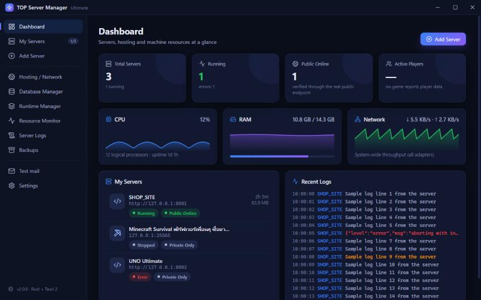

# TOP Server Manager

**Run websites and game servers on your Windows PC – and share them safely – without setting up Apache, MySQL or your router by hand.**

[ภาษาไทยด้านล่าง ↓](#ภาษาไทย)



A Windows 10/11 desktop app (Rust + Tauri 2 + React) and an alternative to XAMPP / Laragon:

- **Web:** PHP 7.4–8.5 (a different version per site) with Caddy, Node.js, static sites, WordPress and Laravel in one click, `.htaccess` rules translated for you, `https://name.test` local domains.
- **Databases:** SQLite, MariaDB, PostgreSQL and Redis, set up automatically per site. Includes a built-in table editor, SQL console, backups and restore, phpMyAdmin, and migration from XAMPP MySQL.
- **Games:** Minecraft Java (Fabric / Paper / Vanilla), Bedrock, and any custom executable, with console, auto-restart and player counts.
- **Sharing:** Cloudflare Tunnel (temporary link or your own domain), LAN, playit.gg, ngrok, Tailscale, FRP or direct IP. A site is shown as *online* only after the app has reached it from the internet.
- **Safety first:**
  - Everything listens on `127.0.0.1` by default, and database ports can never be published.
  - Secrets are encrypted with Windows DPAPI and redacted from logs.
  - Every runtime download is checked against its SHA-256.
  - Nothing is changed in your router or firewall without asking.

## Download
Get `TOP-Server-Manager-Setup.exe` from the [Releases](../../releases) page. It installs per user, with no admin rights needed.

The installer is not code-signed yet, so Windows SmartScreen may warn you. Choose **More info → Run anyway**.

## Guide
- **[Illustrated guide (Thai / English)](docs/guide/index.html):** every page of the app, with numbered screenshots. Open the file in a browser.
- [Full manual (Thai)](docs/README_TH.md)
- [Technical overview (English)](docs/README_EN.md)
- [Security review](docs/SECURITY_REVIEW.md) · [Test report](docs/TEST_REPORT.md)

## Build from source
Requires Rust (stable), Visual Studio 2022 C++ Build Tools and Node.js 20+.
```
npm ci
cargo test -p tsm-core
npx tauri build
```
The installer is written to `target/release/bundle/nsis/`.

## Reporting bugs
Open an [issue](../../issues/new/choose) and pick **Bug report**. The form asks for your Windows version, the app version and the steps to reproduce. Use **Server Logs → Export** to attach logs, since passwords and tokens are already removed from them.

Found a security problem? Please don't open a public issue. See [SECURITY.md](SECURITY.md).

## License
[MIT](LICENSE). Third-party components are listed in [THIRD_PARTY_NOTICES.md](THIRD_PARTY_NOTICES.md).

---

## ภาษาไทย

**เปิดเว็บและเซิร์ฟเวอร์เกมบนคอม Windows ของคุณ แล้วแชร์ให้คนอื่นเข้าได้อย่างปลอดภัย โดยไม่ต้องตั้ง Apache, MySQL หรือเราเตอร์เอง**

- **เว็บ:**
  - PHP 7.4–8.5 (แต่ละเว็บใช้คนละรุ่นได้) ทำงานคู่กับ Caddy, Node.js และเว็บ HTML
  - ติดตั้ง WordPress หรือ Laravel ได้ในคลิกเดียว
  - ใช้ไฟล์ `.htaccess` เดิมได้เลย
  - เปิดเว็บด้วยชื่อ `https://ชื่อ.test` ได้
- **ฐานข้อมูล:** SQLite, MariaDB, PostgreSQL และ Redis ตั้งให้อัตโนมัติ มีตัวแก้ข้อมูลในตาราง หน้าพิมพ์คำสั่ง SQL ระบบสำรองและกู้คืน phpMyAdmin และย้ายข้อมูลจาก XAMPP ได้
- **เกม:** Minecraft Java และ Bedrock รวมถึงโปรแกรมเซิร์ฟเวอร์อื่น ๆ มีคอนโซล เปิดใหม่เองเมื่อล่ม และแสดงจำนวนผู้เล่น
- **แชร์ให้คนอื่นเข้า:** Cloudflare Tunnel, LAN, playit.gg, ngrok, Tailscale, FRP หรือ IP ตรง แอปจะขึ้นว่า "ออนไลน์" ก็ต่อเมื่อลองเข้าจากอินเทอร์เน็ตได้จริงแล้วเท่านั้น
- **ปลอดภัยไว้ก่อน:**
  - ทุกอย่างเปิดเฉพาะในเครื่องเป็นค่าเริ่มต้น และพอร์ตฐานข้อมูลเปิดออกอินเทอร์เน็ตไม่ได้เลย
  - รหัสผ่านถูกเข้ารหัสเก็บไว้
  - ไฟล์ที่ดาวน์โหลดทุกไฟล์ถูกตรวจ SHA-256 ก่อนติดตั้ง
  - ไม่แตะเราเตอร์หรือ Firewall โดยไม่ถามก่อน

**ดาวน์โหลด:**
- ดาวน์โหลด `TOP-Server-Manager-Setup.exe` จากหน้า [Releases](../../releases)
- ถ้า Windows ขึ้นเตือน SmartScreen ให้กด **More info → Run anyway** (เพราะตัวติดตั้งยังไม่มีลายเซ็นดิจิทัล)

**คู่มือ:**
- [คู่มือพร้อมภาพ (ไทย / อังกฤษ)](docs/guide/index.html)
- [คู่มือฉบับเต็ม](docs/README_TH.md)

**แจ้งบั๊ก:**
- เปิด [Issue](../../issues/new/choose) แล้วเลือก **Bug report**
- แนบ log จากหน้า **บันทึกเซิร์ฟเวอร์ → ส่งออก** ได้เลย รหัสผ่านและ token ถูกซ่อนให้แล้ว
- ถ้าเจอช่องโหว่ความปลอดภัย อย่าโพสต์สาธารณะ ดูวิธีแจ้งที่ [SECURITY.md](SECURITY.md)
